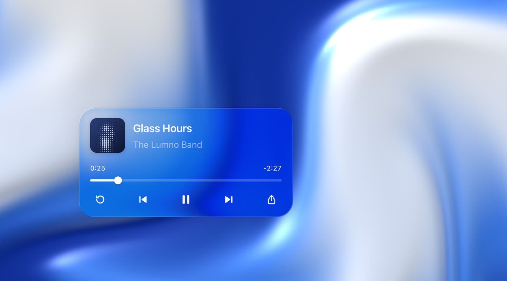

<div align="center">

# liquidglass

**Liquid glass for React.**
<br />
A rim that bends the light, a line where it catches, and ink that reads the wallpaper.

[](https://www.npmjs.com/package/@myna/liquidglass)
[](./packages/liquidglass)
[](./LICENSE)

<a href="https://mywsq.github.io/liquidglass/"></a>

**[Live demo](https://mywsq.github.io/liquidglass/)** · [npm](https://www.npmjs.com/package/@myna/liquidglass) · [GitHub](https://github.com/myWsq/liquidglass)

</div>

<br />

Most "glass" on the web is a blur with a white wash. Real glass does something a blur
can't: it **bends what's behind it**, hardest at the edge, and splits a little colour
there. liquidglass gives any React element that rim, plus the five layers that make it
read as a material, and lets it look at the wallpaper behind it to choose its own ink.

```tsx
import { Glass } from "@myna/liquidglass";
import "@myna/liquidglass/styles.css";

<Glass>Hello, glass.</Glass>;
```

## Install

```sh
npm install @myna/liquidglass
```

React 19.2 or newer. No build plugin, no styling system to adopt: one component, one
stylesheet. It ships as a client module (`"use client"`), so it drops straight into a
Next.js App Router page.

## Quick start

Put glass on top of anything. Inside a `<Liquid>`, it reads the flowing wallpaper
under it and keeps its text legible as the currents pass.

```tsx
import { Glass, Liquid } from "@myna/liquidglass";
import "@myna/liquidglass/styles.css";

export function App() {
  return (
    <Liquid theme="light" style={{ height: "100vh" }}>
      <Glass as="section" style={{ width: 380, padding: 20 }}>
        <h2 className="liquidglass-ink">Glass Hours</h2>
        <p className="liquidglass-sub">The Lumno Band</p>
      </Glass>
    </Liquid>
  );
}
```

`liquidglass-ink` and `liquidglass-sub` are the material's two ink strengths. They blend into
the glass, so text takes on a little of the colour behind it.

## The material

Six layers on one element, on any wallpaper, light or dark.

| Layer               | What it does                                                                                                                                    |
| ------------------- | ----------------------------------------------------------------------------------------------------------------------------------------------- |
| **01 Shadow**       | Lifts the card off the wallpaper, faintly: the rim does most of the work.                                                                       |
| **02 Blur & light** | `blur(2px) saturate(1.8) brightness(1.06)`. Softens what is behind just a little and deepens its colours, so the glass stays clear.             |
| **03 Rim lens**     | A thick slab: a 44px rim bends the wallpaper hard at the edge and eases off inward, the middle magnifies a little, red bends further than blue. |
| **04 Tint**         | A thin wash, 6–22%, thicker over busy wallpaper so text holds. The colour comes from behind.                                                    |
| **05 Rim light**    | A bright line where the light hits the top left, a softer one at the bottom right, a glow just inside.                                          |
| **06 Ink**          | One ink in two strengths, blended into the glass. Dark over bright backdrops, light over dim ones.                                              |

All of it compiles down to four declarations. Use them on your own elements, too:

```css
.my-card {
  background: var(--glass-tint);
  backdrop-filter: var(--glass-blur) var(--glass-lens);
  box-shadow: var(--glass-edge);
  color: var(--glass-ink);
}
```

## How the rim bends

For every pixel, liquidglass takes `d`, the distance to the rounded edge, and looks inward
by

```
offset = refraction × rim × (1 − d / rim) ^ falloff   +   magnify × (distance to the centre)
```

Red, green and blue are displaced by `1 + dispersion`, `1` and `1 − dispersion`, which
splits colour at the rim. The map is rebuilt whenever the element changes size, and
cached by size. It runs one of two ways:

- **Filter** (Chromium). The offsets become an image for an SVG `feDisplacementMap`,
  applied with `backdrop-filter: url(#…)`. It bends whatever is behind the glass.
- **Canvas** (every other browser). Glass copies the backdrop pixels under it from its
  `<Liquid>` (or a `<Backdrop>` with `capture`), bends them with the same map on the
  CPU, once per frame, and lets CSS blur the result. The tint and rim light move to
  `::after` so they stay on top.

`lens="auto"` picks the filter where it runs and the canvas elsewhere. Glass over
ordinary page content in Safari or Firefox has no pixels to copy, so it keeps every
layer except the lens.

## Reading the wallpaper

CSS can't see the pixels behind an element, so glass asks its backdrop. `<Liquid>`
answers for you. For a wallpaper of your own, wrap it in `<Backdrop>`:

```tsx
import { Backdrop, Glass, canvasCapture, canvasSampler } from "@myna/liquidglass";

<Backdrop sample={canvasSampler(myCanvas)} capture={canvasCapture(myCanvas)} interval={200}>
  <Glass ink="auto">…</Glass>
</Backdrop>;
```

A sampler is any function from a viewport rectangle to `{ luminance, busyness }`, both
0–1. Glass switches to light ink below 0.47 and back above 0.53, so it never flickers on
the boundary, and raises its wash as `busyness` grows. `capture` is optional: it hands
the pixels over so the canvas lens can refract them outside Chromium.

## API

### `<Glass>`

Renders a `div` by default; pass `as` for any other element, and its props come along.

| Prop                               | Default              | Description                                                                |
| ---------------------------------- | -------------------- | -------------------------------------------------------------------------- |
| `as`                               | `"div"`              | Element or component to render.                                            |
| `radius`                           | `28`                 | Corner radius in px, or `"pill"`.                                          |
| `rim`                              | `44`                 | Width of the refracting band, px.                                          |
| `refraction`                       | `1.1`                | How far the rim reaches inward, × `rim`.                                   |
| `falloff`                          | `2.6`                | How quickly the bend eases off away from the edge.                         |
| `magnify`                          | `0.05`               | Pull toward the middle.                                                    |
| `dispersion`                       | `0.15`               | Colour split at the rim.                                                   |
| `blur` · `saturate` · `brightness` | `2` · `1.8` · `1.06` | The backdrop filter.                                                       |
| `tint`                             | `"auto"`             | Wash strength 0–1. `"auto"`: 6–22% by busyness, 12% without a backdrop.    |
| `tintScale`                        | `1`                  | Multiplier on the wash: a number, or `{ light, dark }` per appearance.     |
| `ink`                              | `"auto"`             | `"dark"`, `"light"`, or chosen from the backdrop.                          |
| `lens`                             | `"auto"`             | `"filter"`, `"canvas"`, `false`, or the best one this browser can run.     |
| `onReading`                        |                      | `({ luminance, busyness, ink, tint }) => void`, each time the glass reads. |

### `<Liquid>`

A flowing liquid wallpaper drawn by a WebGL2 shader; the currents drift on their own. Glass
inside reads it.

| Prop          | Default   | Description                                                              |
| ------------- | --------- | ------------------------------------------------------------------------ |
| `theme`       | `"light"` | Cross-fades between the light and dark palettes.                         |
| `colors`      |           | `{ light?, dark? }`: override `deep mid pale warm env spec`.             |
| `speed`       | `1`       | Flow speed multiplier.                                                   |
| `scale`       | `3.4`     | How many currents fit on screen.                                         |
| `bump`        | `0.05`    | How wet and three-dimensional the surface looks.                         |
| `paused`      | `false`   | Freeze the flow.                                                         |
| `resolution`  | `0.75`    | Render resolution as a fraction of device pixels.                        |
| `canvasProps` |           | `className` and `style` for the canvas, e.g. to blur it behind a dialog. |
| `ref`         |           | `{ canvas, live, draw(), sample(rect) }`.                                |

### Lens utilities

`createLensMap({ width, height, radius, rim?, refraction?, falloff?, magnify? })` returns
the displacement map as offsets and a data URL. `applyLens(imageData, map, options?)` runs
it on the CPU, for snapshots and diagrams. `supportsLens()` tells you whether the
browser can run it as a filter.

### `<Backdrop>`

`sample` (required), `capture`, and `interval` (ms between re-reads, default 200).
`canvasSampler(canvas)` and `canvasCapture(canvas)` build the first two for a canvas.
`useBackdrop()` returns the nearest backdrop source, for your own components.

## Browser support

|                             | Chrome · Edge | Safari · Firefox |
| --------------------------- | ------------- | ---------------- |
| Blur, tint, rim light, ink  | ✓             | ✓                |
| Rim lens over `<Liquid>`    | ✓ filter      | ✓ canvas         |
| Rim lens over other content | ✓ filter      | blur only        |
| `<Liquid>`                  | ✓             | ✓                |

Without WebGL2, `<Liquid>` renders one still frame of the same liquid on the CPU. With
`prefers-reduced-motion`, it holds still.

## The demo

[The demo](https://mywsq.github.io/liquidglass/) is `apps/pages`. **Material** shows the
four declarations and the card's live light/dark reading, with a switch between the
filter and canvas lens. **Layers** flies the card to the middle and pulls its six layers
apart in 3D, then puts it back where you left it.

```sh
pnpm install
pnpm dev
```

## License

[MIT](./LICENSE)
